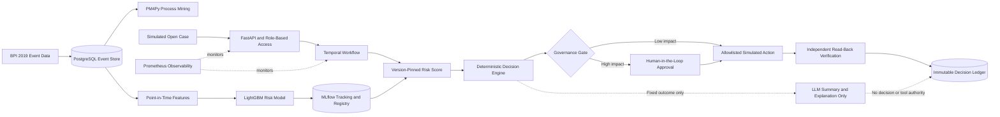

# DecisionFlow

[](https://github.com/ozzy2438/DecisionFlow/actions/workflows/ci.yml)
[](LICENSE)
[](backend/pyproject.toml)

**DecisionFlow is a production-grade AI portfolio/reference system that uses real
Purchase-to-Pay event data to predict SLA risk, applies deterministic business rules, requests
Human-in-the-Loop approval when required, executes controlled actions in a Digital Twin, verifies
the result through read-back, and records every decision in an immutable Decision Ledger.**

It demonstrates the engineering work between a prediction and a trustworthy operational outcome.
No real ERP, supplier, bank, or payment system is connected.

## Problem

Purchase-to-Pay cases can stall between purchase-order creation, goods receipt, invoice receipt,
and invoice clearance. A risk model can identify a likely SLA breach, but a probability alone does
not answer the operational question:

> Is this open case likely to miss its SLA, and which safe action is permitted now?

DecisionFlow solves this single bounded decision problem over the public BPI Challenge 2019
Purchase-to-Pay history.

## Why it matters

Applied AI systems fail when model output is treated as permission to act. A useful enterprise
decision system also needs explicit policy, authorization, durable execution, verification, and
evidence.

DecisionFlow separates those responsibilities:

- LightGBM estimates risk; it does not choose an action.
- Versioned deterministic rules select the permitted action.
- High-impact actions pause for a separate human approver.
- Temporal makes the workflow durable across retries and worker restarts.
- Tools can mutate only the simulated operational twin.
- Independent read-back confirms the requested state actually exists.
- An append-only SHA-256 chain preserves the complete decision record.
- The optional LLM explains a fixed outcome; it has no business-decision authority.

## Architecture



The LLM cannot make the final decision, execute tools, issue payments, change thresholds, elevate
permissions, approve an action, or run SQL.

## Decision Flow

| Stage | Responsibility | Evidence produced |
| --- | --- | --- |
| Detect | MLflow-pinned LightGBM candidate scores the case | model version, policy version, feature hash, risk score |
| Decide | Deterministic policy maps score and case state to an action | rule ID/version, thresholds, reason, impact |
| Approve | Separate approver reviews high-impact actions | identity, outcome, rationale, timestamp |
| Act | Allowlisted tool writes only to the Digital Twin | idempotency key, request, response, execution status |
| Verify | New transaction reads the resource back | expected state, observed state, pass/fail |
| Audit | Ledger appends the complete result | ordered events, previous hash, entry hash, verified head |

The versioned `p2p-action-policy-v1` policy is intentionally small:

| Condition | Action | Impact | Approval |
| --- | --- | --- | --- |
| risk below `0.50` | `NO_ACTION` | none | no |
| risk at least `0.50` | `CREATE_FOLLOW_UP_TASK` | low | automatic |
| risk at least `0.80`, invoice present, required goods receipt absent | `PLACE_SIMULATED_PAYMENT_HOLD` | high | separate human required |

## Tech Stack

| Layer | Technology |
| --- | --- |
| Event store and operational twin | PostgreSQL 16 |
| Process discovery | PM4Py |
| Risk prediction | LightGBM, scikit-learn |
| Experiment tracking and model registry | MLflow |
| Decision policy | Versioned deterministic Python rules |
| Durable orchestration | Temporal Workflow, Activities, Worker |
| Explanation boundary | OpenAI Structured Outputs or labeled deterministic fallback |
| API and authorization | FastAPI, Pydantic, role-scoped bearer tokens |
| Frontend | React, TypeScript, Vite, hardened Nginx |
| Monitoring | Prometheus metrics and alert rules |
| Delivery | Docker Compose, GitHub Actions, Dependabot |

## Demo

Start the complete system and run both acceptance scenarios:

```bash
make up
make smoke
```

Open [http://localhost:18766](http://localhost:18766) for the visual demo.

### Scenario A — Automatic low-risk action

`Case → risk 0.6346 → deterministic decision → automatic follow-up → Temporal execution →
read-back PASS → immutable audit ledger`

This case is below the high-impact threshold. The allowlisted follow-up task is applied
automatically in the Digital Twin, exactly once.

### Scenario B — Governed high-impact action

`Case → risk 0.99898 → deterministic decision → HITL approval → simulated payment hold →
Temporal execution → read-back PASS → immutable audit ledger`

The workflow remains paused with zero tool executions until a separate approver records an
outcome. See the recruiter-oriented [2–3 minute demo script](docs/DEMO.md).

## Results

### Real process evidence

| Measure | Verified value |
| --- | ---: |
| Purchase-order line-item cases | 251,734 |
| Events | 1,595,923 |
| Activities | 42 |
| Process variants | 11,973 |
| Directly-follows edges | 498 |

The source is the historical BPI Challenge 2019 event log. Raw timestamps are preserved, including
documented outliers; the modeling cohort is selected explicitly rather than silently rewriting
source evidence.

### LightGBM Candidate v2

The model uses `sla-proxy-v1`: a documented 90-day proxy SLA, a seven-day point-in-time observation
window, censored incomplete outcomes, and chronological train/validation/test partitions.

| Held-out test metric | Value |
| --- | ---: |
| ROC-AUC | **0.871053** |
| Average precision | 0.661269 |
| Brier score | 0.100118 |
| Recall at 0.50 | 0.589044 |

MLflow run `2187d3fb3fe549fe95c46c554351a488` records parameters, metrics, model artifact,
feature importance, training report, source checksum, label policy, and registered model version.
The model remains `candidate`; there is no silent champion promotion.

### Verification snapshot

- **60 backend tests**
- **86.35% branch-aware coverage**
- Ruff and strict mypy
- Frontend tests and TypeScript production build
- npm audit: **0 vulnerabilities**
- Temporal retry and worker-recovery verified against a real Temporal server
- Immutable SHA-256 chained Decision Ledger
- Idempotent action execution
- Prometheus monitoring and validated alert rules

See the [System Card / Production Evidence](docs/SYSTEM_CARD.md) for claim-level evidence and
limitations.

## Governance

- **Non-authoritative LLM:** receives an allowlisted simulated payload only after the model and
  rules fix the result; no tools or SQL are exposed.
- **Deterministic authority:** thresholds and action mappings live in versioned code, not prompts.
- **Human-in-the-Loop:** high-impact actions require an approver role and separation of duties.
- **Simulation boundary:** database constraints require twin cases to be simulated; there is no
  ERP or payment connector.
- **Model governance:** scoring fails closed unless the MLflow version is `READY`, tagged
  `candidate`, and carries the expected policy and source provenance.
- **Audit integrity:** PostgreSQL triggers reject update/delete operations on governance records;
  every ledger read recomputes the SHA-256 chain.
- **Credential boundary:** the default template provider receives no OpenAI key; optional provider
  secrets are supplied only through the project-prefixed runtime variable.

## Reliability

| Control | Verified behavior |
| --- | --- |
| Temporal retry | a transient Activity failure completed on attempt 2 |
| Worker recovery | approval signal persisted while the worker was offline; restart produced one verified execution |
| Idempotency | repeated evaluation returned the same decision and one twin resource |
| Approval enforcement | unauthorized approval returned HTTP 403; pending action count remained zero |
| Read-back failure | fault injection failed closed and recorded the failed verification |
| Ledger mutation | direct PostgreSQL update/delete attempts were rejected |
| Dependency readiness | API returns 503 when PostgreSQL, MLflow, or Temporal is unavailable |
| Monitoring | Prometheus scrapes the API and evaluates availability, 5xx, and p95-latency rules |

## Local Setup

### Prerequisites

- Docker Engine/Desktop with Compose
- internet access on the first run
- approximately 6 GB free disk space

### One-command bootstrap

```bash
git clone https://github.com/ozzy2438/DecisionFlow.git
cd DecisionFlow
make up
```

On a fresh volume, `make up`:

1. starts PostgreSQL, MLflow, Temporal, the API, worker, and React UI;
2. downloads the official BPI XES file and verifies its pinned size and MD5;
3. applies migrations and streams the full event log into PostgreSQL;
4. runs data-quality gates and PM4Py discovery;
5. trains and registers a matching LightGBM candidate when needed;
6. starts the non-root application containers.

The first run is intentionally substantial. Later runs reuse the verified import and model.

Local-only demo credentials:

- operator: `operator-local-demo-key`
- approver: `approver-local-demo-key`
- auditor: `auditor-local-demo-key`

Useful commands:

```bash
make smoke          # low-impact and HITL acceptance paths
make test           # PostgreSQL + real Temporal integration suite and coverage
make lint           # Ruff + strict mypy
make frontend-test  # npm audit, TypeScript, tests, production build
make monitoring     # optional Prometheus profile
make down           # stop containers and retain volumes
```

Optional OpenAI explanations are disabled by default:

```bash
DECISIONFLOW_LLM_PROVIDER=openai \
DECISIONFLOW_OPENAI_API_KEY=... \
make up
```

Provider failure never changes the deterministic decision; it produces a clearly labeled
`TEMPLATE_FALLBACK` explanation.

Repository layout:

```text
DecisionFlow/
├── backend/                 # API, ingest, process mining, ML, governance, Temporal, tests
├── frontend/                # React/TypeScript operator and approver UI
├── docs/                    # demo, system card, CV and LinkedIn copy
├── monitoring/              # Prometheus scrape and alert rules
├── scripts/smoke_demo.py    # live acceptance flow
├── compose.yaml
├── Makefile
├── .env.example
└── README.md
```

## Limitations

- **Reference system, not live enterprise deployment.** DecisionFlow is production-grade as a
  portfolio/reference implementation, but it is not deployed inside a real ERP or payment
  environment and reports no fabricated business impact.
- **Assumed SLA.** BPI 2019 has no authoritative corporate SLA label. The 90-day target is an
  explicit modeling proxy that requires owner approval before real use.
- **Candidate model.** Version 2 passed the declared offline gates but is deliberately not promoted
  to champion or production.
- **Simulated actions only.** Follow-up tasks and payment holds exist solely in PostgreSQL twin
  tables.
- **Historical-data limits.** Results describe the published research event log, not current
  organizational performance.
- **LLM is optional.** The default deterministic template keeps the complete decision path
  credential-free; a live provider requires a valid external key.
- **Deployment controls remain owner work.** Real deployment requires organization-approved
  thresholds, managed secrets, TLS, backups, retention, privacy/security review, load testing,
  incident response, and alert routing.

### License and third-party data use

DecisionFlow source code is released under the **GNU Affero General Public License v3.0**; see
[LICENSE](LICENSE). PM4Py Community is also AGPL-3.0. Closed-source commercial use of PM4Py may
require a separate commercial license from its owner.

The BPI Challenge 2019 dataset is authored by Boudewijn van Dongen and published by
4TU.ResearchData under **CC BY 4.0**, DOI
[10.4121/uuid:d06aff4b-79f0-45e6-8ec8-e19730c248f1](https://doi.org/10.4121/uuid:d06aff4b-79f0-45e6-8ec8-e19730c248f1).
The 728,558,522-byte raw XES file is not redistributed in this repository. DecisionFlow downloads
it from the publisher at runtime, verifies MD5 `4eb909242351193a61e1c15b9c3cc814`, and preserves
source attribution.
